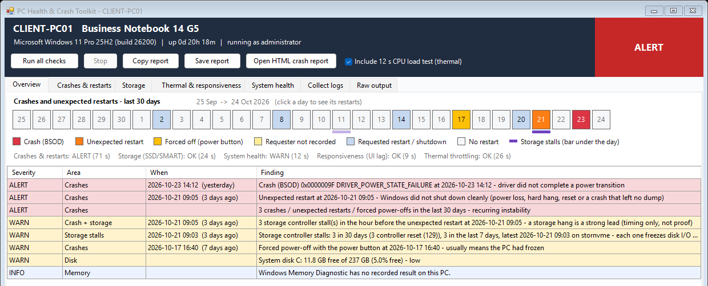

# PC Health and Crash Toolkit: why did this PC restart?

A WinForms tool for **Windows PowerShell 5.1** for the ticket that says "my PC keeps restarting", "it blue-screened" or "it's slow and freezes". One window runs five checks and lays the last 30 days out on a calendar: crashes, unexpected restarts, forced power-offs and requested restarts, each with who or what asked for it. Then it lists every finding by severity, with storage stalls lined up against the restarts they may have caused.

From [ihavenoram.com](https://ihavenoram.com): field notes for ADHD techs running managed services.



## Download

Grab **`pchealth.zip`** from **[Releases](../../releases/latest)**. It holds one folder, `pchealth\`, with only what runs: the scripts and a `.cmd` launcher for each. Copy that folder to the PC or server (for example `C:\temp\pchealth`); this README and the docs stay here on GitHub. The SHA-256 checksum is in the release notes and in the `.sha256` file beside the zip:

```powershell
Get-FileHash .\pchealth.zip -Algorithm SHA256
```

## Run it

Unzip it anywhere (for example `C:\temp\pchealth`) and double-click **`PC_Health_Crash_Toolkit.cmd`**. On a desktop it asks for elevation (UAC); several checks need it.

**In ScreenConnect Backstage** it runs as SYSTEM and goes straight in: copy the folder over, run the `.cmd`, and work the problem without touching the user's screen.

## What it checks

| Tab | |
|---|---|
| **Overview** | The 30-day calendar (click a day to see its restarts) and every finding by severity |
| **Crashes & restarts** | Every shutdown and restart, newest first: bugcheck codes and dumps, power-button holds, unclean shutdowns, and **who requested** each orderly one (a person, Windows Update, a scheduled task, an app) |
| **Storage** | SSD/SMART health and controller stalls (asks before installing smartmontools) |
| **Thermal & responsiveness** | CPU throttling (with an optional 12-second load test) and UI lag |
| **System health** | System-disk space, memory, drivers, Windows integrity, battery and power |
| **Collect logs** | Tick minidumps, LiveKernelReports, WER reports, event logs and the reports, and zip them to `C:\temp`. A full `MEMORY.DMP` is copied beside the zip |

**Copy report** puts a plain-text report on the clipboard for the ticket; **Save report** writes it to `C:\temp`.

## The HTML crash report

**`Crash_Incident_Viewer.html`** is a single HTML file that turns the crash diagnostic's output into a readable report: a timeline per machine, what's established and what isn't, and what to ask the client. It runs entirely in your browser, offline; nothing is uploaded.

- **From the toolkit:** **Open HTML crash report** writes a copy with this PC's data built in, so you can attach it to the ticket or email it.
- **On its own:** open the file, then paste (or drop) the diagnostic's output from any number of machines, for example straight from an RMM script's output. **Load demo** shows three made-up machines.

## Files

| File | Purpose |
|---|---|
| `PC_Health_Crash_Toolkit.cmd` | Launcher |
| `PC_Health_Crash_Toolkit.ps1` | The window. It runs the scripts below in the background, each with a timeout, so it never freezes |
| `System_Crash_And_Shutdown_Incident_Diagnostic.ps1` | Crashes, restarts and who requested them |
| `SSD_Hard_Drive_Info_Health_Status_Enhanced.ps1` | Disk and SMART health |
| `System_Health_Extras_Check.ps1` | Disk space, memory, drivers, integrity, battery |
| `System_UI_Lag_And_Responsiveness_Diagnostic.ps1` | UI lag |
| `CPU_Thermal_Throttling_Diagnostic_Check.ps1` | Thermal throttling |
| `Crash_Incident_Viewer.html` | The HTML crash report |

Each check script also runs on its own, for example as an RMM script: they were written that way first. Each has its own **`Launch-<script>.cmd`** beside it, which asks for elevation (UAC) unless it's already elevated or running as SYSTEM, and waits for a key at the end so the output stays on screen (`/noelevate` and `/nopause` turn those off).

## Notes

- Windows PowerShell 5.1, no modules. smartmontools is optional and only installed if you say yes.
- Reports, collected logs and dumps go to `C:\temp`. They describe a real PC.
- A crash's *cause* still needs the dump analysed (WinDbg `!analyze -v`); the toolkit tells you which dump, and says plainly when the timing points at something but doesn't prove it.

## About

Built with AI assistance (Claude). It's provided as is, with no warranty.

MIT licensed; see [LICENSE](LICENSE).
